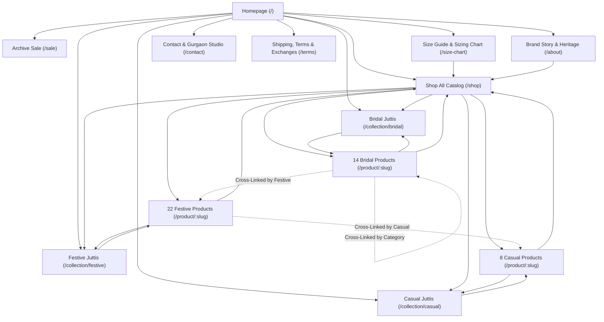

# Comprehensive Internal Linking & Information Architecture Strategy
## Beads & Bloom — Handcrafted Indian Juttis & Ethnic Footwear
**Website Domain:** `https://beadsandbloom.in/`  
**Strategy Lead:** Senior Technical SEO Engineer & E-Commerce Information Architect  

---

## 1. Information Architecture Hierarchy

The website's internal linking architecture follows a crawlable e-commerce hierarchy structured around verified catalog data from MongoDB:

---

## 2. Component-by-Component Internal Linking Specifications

### A. Header & Primary Navigation (`Navbar.jsx`)
1. **Desktop Navigation Structure:**
   - **Logo:** Crawlable `<Link to="/">BEADS & BLOOM</Link>`
   - **The Collection:** `<Link to="/shop">The Collection</Link>` *(Removed non-canonical `/shop?sort=newest`)*
   - **Bridal Edit:** `<Link to="/collection/bridal">Bridal</Link>` *(Preserves confirmed indexed URL)*
   - **Festive Edit:** `<Link to="/collection/festive">Festive</Link>` *(Exposes the largest 22-product catalog tier)*
   - **Casual Edit:** `<Link to="/collection/casual">Casual</Link>` *(Exposes the 8-product daily wear tier)*
   - **Our Story:** `<Link to="/about">Our Story</Link>`
   - **Sale:** `<Link to="/sale">Sale</Link>`
2. **Mobile Navigation Parity:**
   - Every single link in the desktop navigation is mirrored in the slide-out mobile drawer with prominent `<Link to="...">` anchors and Lucide chevron arrows.
   - Prevents Google Smartphone crawler from missing deep categories on mobile passes.

### B. Homepage Internal Links (`HomePage.jsx`)
1. **Hero Slider (`HeroNew.jsx`):**
   - Direct CTA links to `/shop` ("Shop The Collection") and `/collection/bridal` ("Explore Bridal Edit").
2. **Collection Showcase (`CollectionTiles.jsx`):**
   - Replaced broken product-name parameter queries (`/shop?category=Blush%20Mirage`) with direct links to verified collections:
     - **Bridal Juttis:** `/collection/bridal` (14 designs)
     - **Festive Juttis:** `/collection/festive` (22 designs)
     - **Casual Juttis:** `/collection/casual` (8 designs)
   - Descriptive anchor headers (`<h3>Bridal Juttis</h3>`, `<h3>Festive Juttis</h3>`, `<h3>Casual Juttis</h3>`).
3. **Curated Favorites (`BestSellers.jsx`):**
   - Links directly to top 3 verified bestseller products with product name anchor tags.
   - Secondary link to `/shop` ("View All Bestsellers").
4. **Runway Video Showcase (`VideoShowcase.jsx`):**
   - Cleaned fallback links from parameterized `/shop?category=...` to canonical `/collection/bridal`, `/collection/festive`, `/collection/casual`.
5. **Brand Story (`BrandStory.jsx`):**
   - Contextual CTAs:
     - "Read Our Heritage Story" -> `/about`
     - "Explore All Handcrafted Juttis" -> `/shop`
6. **Store Trust & FAQs (`StoreTrustFAQ.jsx`):**
   - Contextual links to `/contact` for Gurgaon studio inquiries, `/terms` for COD and shipping terms, and `/size-chart` for sizing assistance.

### C. Collection Page Architecture (`Collection.jsx`)
1. **Breadcrumbs:**
   - Visible crawlable path: `Home` (`/`) > `Shop` (`/shop`) > `Current Collection` (`/collection/:category`).
2. **Product Grid:**
   - Every product card features:
     - Crawlable `<Link to="/product/:slug">` enclosing product image with descriptive `alt` text.
     - Crawlable `<Link to="/product/:slug">` enclosing the semantic `<h3>{product.name}</h3>`.
3. **Related Collections Navigation Strip:**
   - At the bottom of each collection page, contextual links to complementary collections:
     - On `/collection/bridal`: Links to `/collection/festive` and `/collection/casual`.
     - On `/collection/festive`: Links to `/collection/bridal` and `/collection/casual`.
     - On `/collection/casual`: Links to `/collection/bridal` and `/collection/festive`.
4. **Crawlable Fallback Content:**
   - Introduces concise, intent-rich descriptions explaining the craftsmanship, embroidery, and cushioning specific to that collection.

### D. Product Detail Page Architecture (`ProductDetail.jsx`)
1. **Universal Mobile & Desktop Breadcrumbs:**
   - Relocated breadcrumbs out of `hidden lg:grid` into a primary above-the-fold position visible across both mobile and desktop screen widths:
     `Home (/)` > `Shop (/shop)` > `[Primary Collection] (/collection/:category)` > `[Product Name]`
2. **Contextual Collection Badge:**
   - In product information column: Display clean collection tag linking to `/collection/:category` (e.g. "Bridal Edit", "Festive Edit").
3. **Robust Related Products (`RelatedProducts.jsx`):**
   - **Critical Fix:** Component now checks if Redux `items` is populated. If empty (standalone page crawl), it performs a direct API fetch:
     `GET /api/products?category=${product.category}&pageSize=4`
   - Genuinely matches products by shared category, style, or occasion.
   - Guarantees that Googlebot always sees 4 crawlable product links with product names as anchor text, permanently eliminating isolated orphan product pages.
4. **Recently Viewed Strip:**
   - Displays crawlable links to recently viewed products stored in browser history.
5. **Sizing Guidance Link:**
   - "Unsure about your fit? View our Jutti Size Guide" linking directly to `/size-chart`.

### E. Footer Architecture (`Footer.jsx`)
Structured into 4 user-oriented, crawlable columns:
1. **Handcrafted Juttis:**
   - `/shop` ("Complete Jutti Range")
   - `/collection/bridal` ("Bridal & Wedding Juttis")
   - `/collection/festive` ("Festive & Sangeet Juttis")
   - `/collection/casual` ("Casual Everyday Chic")
   - `/sale` ("Archive Festive Sale")
2. **About & Support:**
   - `/about` ("Our Story & Heritage")
   - `/size-chart` ("Size Guide & Fit Tips")
   - `/terms` ("Worldwide Shipping & COD")
   - `/contact` ("Gurgaon Studio & Contact")
   - `/track-order` ("Track Your Order")
3. **Studio Contact & Socials:**
   - Physical address details in Online Atelier.
   - Official social media links (`https://www.instagram.com/beadsnbloom.india`).
4. **Legal & Policies:**
   - `/terms` ("Terms of Service", "Privacy Policy", "Exchange Policy").

---

## 3. Anchor Text Best Practices & Quality Controls

| Link Destination | Target Anchor Text Pattern | Anti-Patterns Avoided |
| :--- | :--- | :--- |
| `/collection/bridal` | "Bridal Juttis", "The Bridal Edit", "Bridal & Wedding Juttis" | "Click here", "View more", "Bridal bridal shoes buy online cheap" |
| `/collection/festive` | "Festive Juttis", "The Festive Edit", "Festive & Sangeet Juttis" | "Collection 2", "Explore" (standalone) |
| `/collection/casual` | "Casual Juttis", "Everyday Chic", "Casual Everyday Juttis" | "Casual shoes", "Flat shoes" (non-descriptive) |
| `/product/:slug` | Exact verified product name (e.g., "Neel Pari - Beige Embroidered Festive Jutti") | "Product", "Buy", image-only click handlers |
| `/about` | "Our Story & Heritage", "Read Our Heritage Story" | "Read more", "About us" (generic) |
| `/size-chart` | "Jutti Size Guide", "Size Chart & Footwear Guide" | "Help", "Info" |

---

## 4. Preventing Parameter Dilution & Crawl Budget Waste

1. **Elimination of Parameter Links:**
   - No primary internal navigation link points to URL search queries (`?sort=...`, `?category=...`, `?keyword=...`).
   - Every primary navigation anchor resolves to a clean canonical pathname.
2. **Facet & Filter Containment:**
   - Size and price range filters on `/shop` modify client state and URL query parameters for user convenience, while setting self-referencing canonicals back to `/shop`.
   - Internal links leading into `/shop` from headers, footers, and breadcrumbs always use the pure canonical `/shop`.
