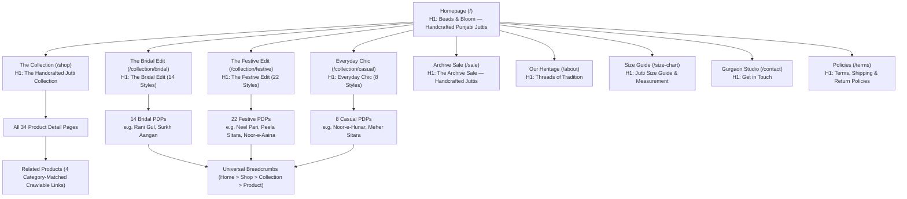

# BEADS & BLOOM — MASTER SEO CONTENT MAP & ROUTE ARCHITECTURE
**Domain:** `https://beadsandbloom.in/`  
**Brand:** Beads & Bloom (Artisanal Luxury Handcrafted Indian Juttis & Mojris)  
**Studio Location:** Sector 15, Gurugram (Gurgaon), Haryana 122001, India  
**Audited Canonical Public Inventory:** 44 Routes (10 Hubs/Collections + 34 Handcrafted Products)  
**Status:** Implemented & Verified in Codebase  

---

## 1. Information Architecture & Content Hierarchy

---

## 2. Master Route Content Map: Core Hubs & Informational Pages (10 Routes)

### 1. `/` — Homepage Hub
- **URL:** `https://beadsandbloom.in/`
- **Page Type:** Homepage Hub
- **Search Intent:** Commercial / Navigational ("handcrafted juttis", "punjabi jutti online", "jutti store gurgaon")
- **Primary Topic / Keyword:** Handcrafted Punjabi Juttis & Luxury Ethnic Footwear
- **Secondary Topics:** Bridal juttis Gurgaon, bite-free cushioned juttis, Sector 15 Gurgaon studio, worldwide shipping, cash on delivery (COD).
- **H1:** `Beads & Bloom — Handcrafted Punjabi Juttis & Ethnic Footwear` (Semantic screen-reader accessible with brand headline)
- **Title Tag:** `Handcrafted Juttis | Bridal, Festive & Casual | Store in Gurgaon - Beads and Bloom`
- **Meta Description:** `Discover luxury handcrafted Punjabi juttis, bridal mojris & festive footwear at Beads and Bloom. Visit our store in Sector 15, Gurgaon. Worldwide shipping & Cash on Delivery (COD) available.`
- **Canonical:** `https://beadsandbloom.in/` (Self-referencing)
- **Indexing Decision:** `index, follow`
- **Structured Data:** `ShoeStore`, `Organization`, `WebSite` (with `SearchAction`), `FAQPage` (StoreTrustFAQ)
- **Inbound Internal Links:** 34 product breadcrumb links, all header nav logos, footer copyright & brand links.
- **Outbound Internal Links:** `/shop`, `/collection/bridal`, `/collection/festive`, `/collection/casual`, `/sale`, `/about`, `/size-chart`, `/contact`, `/terms`, `/track-order`, top 3 best-seller PDPs.
- **Content Improvements Implemented:** Enhanced Hero H1 with descriptive subtitle; direct category tiles to verified collections; StoreTrustFAQ with Gurgaon studio address and worldwide delivery terms.

---

### 2. `/shop` — Catalog Hub
- **URL:** `https://beadsandbloom.in/shop`
- **Page Type:** Master Catalog & Product Discovery Hub
- **Search Intent:** Commercial Investigation ("shop juttis online", "designer mojaris collection")
- **Primary Topic / Keyword:** Complete Handcrafted Jutti Catalog
- **Secondary Topics:** Wedding mojris, casual ethnic flats, cushioned juttis EU 36-41.
- **H1:** `The Handcrafted Jutti Collection`
- **Title Tag:** `The Collection — Handcrafted Juttis & Mojris | Beads and Bloom`
- **Meta Description:** `Explore our complete catalog of handcrafted juttis. From opulent bridal zardosi to chic everyday ethnic flats, find your perfect pair with cushioned comfort.`
- **Canonical:** `https://beadsandbloom.in/shop` (Parameter normalization: filters canonicalize to `/shop`)
- **Indexing Decision:** `index, follow`
- **Structured Data:** `CollectionPage`, `BreadcrumbList` (Home > Shop)
- **Inbound Internal Links:** Header nav ("The Collection"), Footer, Homepage CTA buttons, Collection page cross-links, PDP breadcrumbs.
- **Outbound Internal Links:** 4 Category Pills (`/collection/bridal`, `/collection/festive`, `/collection/casual`, `/sale`), all 34 product detail pages, breadcrumbs.
- **Content Improvements Implemented:** Added crawlable category navigation pills immediately below H1; parameter sanitization ensuring sort/filter queries do not dilute canonical index.

---

### 3. `/collection/bridal` — The Bridal Edit
- **URL:** `https://beadsandbloom.in/collection/bridal`
- **Page Type:** Thematic Collection Hub (14 Products)
- **Search Intent:** High-Intent Transactional ("bridal juttis online", "wedding mojaris for bride", "dulhan jutti")
- **Primary Topic / Keyword:** Luxury Bridal & Wedding Juttis
- **Secondary Topics:** Heavy zardozi, dabka, pearls, cut-dana, bite-free 10+ hour wedding comfort, velvet & silk wedding shoes.
- **H1:** `The Bridal Edit`
- **Title Tag:** `The Bridal Edit — Luxury Wedding Juttis & Mojris | Beads and Bloom`
- **Meta Description:** `Walk down the aisle in sublime comfort. Shop exquisite handcrafted bridal juttis featuring heavy zardosi, pearls, and double-padded soles for wedding ceremonies.`
- **Canonical:** `https://beadsandbloom.in/collection/bridal` (Preserved confirmed indexed URL)
- **Indexing Decision:** `index, follow`
- **Structured Data:** `CollectionPage`, `BreadcrumbList` (Home > Shop > The Bridal Edit)
- **Inbound Internal Links:** Header nav ("Bridal"), Footer, Homepage CollectionTiles, VideoShowcase, PDP breadcrumbs, RelatedProducts.
- **Outbound Internal Links:** 14 Bridal product pages, cross-links to `/collection/festive`, `/collection/casual`, `/shop`, `/size-chart`.
- **Content Improvements Implemented:** Added "Bridal Footwear Craft & Styling Guide" (Heirloom Embroidery, 10+ Hour Bite-Free Comfort, Bridal Sizing & Custom Trials); cross-collection internal linking grid.

---

### 4. `/collection/festive` — The Festive Edit
- **URL:** `https://beadsandbloom.in/collection/festive`
- **Page Type:** Thematic Collection Hub (22 Products)
- **Search Intent:** Commercial / Transactional ("festive juttis", "sangeet mojaris", "diwali party footwear")
- **Primary Topic / Keyword:** Festive & Celebration Juttis
- **Secondary Topics:** Mirror work (sheesha), gota patti, resham embroidery, metallic sequin sparkle, sangeet dancing shoes.
- **H1:** `The Festive Edit`
- **Title Tag:** `The Festive Edit — Festive & Occasion Juttis | Beads and Bloom`
- **Meta Description:** `Celebrate every special occasion in artisanal luxury. Shop handcrafted festive juttis featuring dabka, zari, and pearl embroidery with double-cushioned comfort.`
- **Canonical:** `https://beadsandbloom.in/collection/festive` (Self-referencing canonical)
- **Indexing Decision:** `index, follow`
- **Structured Data:** `CollectionPage`, `BreadcrumbList` (Home > Shop > The Festive Edit)
- **Inbound Internal Links:** Header nav ("Festive"), Footer, Homepage CollectionTiles, VideoShowcase, PDP breadcrumbs, RelatedProducts.
- **Outbound Internal Links:** 22 Festive product pages, cross-links to `/collection/bridal`, `/collection/casual`, `/shop`, `/size-chart`.
- **Content Improvements Implemented:** Resolved GSC "Discovered — currently not indexed" status; linked in main desktop/mobile navigation; added "Festive & Sangeet Footwear Guide" (Celebration Artistry, Dance-Ready Cushioning, Styling).

---

### 5. `/collection/casual` — Everyday Chic
- **URL:** `https://beadsandbloom.in/collection/casual`
- **Page Type:** Thematic Collection Hub (8 Products)
- **Search Intent:** Commercial / Transactional ("casual juttis", "daily wear ethnic flats", "comfortable office juttis")
- **Primary Topic / Keyword:** Casual & Daily Wear Handcrafted Juttis
- **Secondary Topics:** Lightweight footwear, breathable genuine leather, bite-free daily flats, kurti & jeans footwear.
- **H1:** `Everyday Chic`
- **Title Tag:** `Everyday Chic — Casual & Office Wear Juttis | Beads and Bloom`
- **Meta Description:** `Step into effortless elegance with our casual handcrafted juttis. Designed for daily wear and office rotations with lightweight, bite-free cushioned soles.`
- **Canonical:** `https://beadsandbloom.in/collection/casual`
- **Indexing Decision:** `index, follow`
- **Structured Data:** `CollectionPage`, `BreadcrumbList` (Home > Shop > Everyday Chic)
- **Inbound Internal Links:** Header nav ("Casual"), Footer, Homepage CollectionTiles, VideoShowcase, PDP breadcrumbs, RelatedProducts.
- **Outbound Internal Links:** 8 Casual product pages, cross-links to `/collection/bridal`, `/collection/festive`, `/shop`, `/size-chart`.
- **Content Improvements Implemented:** Added "Everyday Chic & Office Wear Guide" (Subtle Accents, Breathable Genuine Leather, Day-to-Night Fit).

---

### 6. `/sale` — The Archive Sale
- **URL:** `https://beadsandbloom.in/sale`
- **Page Type:** Archive Sale / Promotional Hub
- **Search Intent:** Transactional / Bargain ("juttis on sale", "discount mojris", "jutti coupon code")
- **Primary Topic / Keyword:** Handcrafted Juttis on Sale & Clearance
- **Secondary Topics:** Coupon INAUGURAL10 (10% extra discount), limited edition archive markdowns.
- **H1:** `The Archive Sale — Handcrafted Juttis`
- **Title Tag:** `Archive Sale — Exclusive Offers on Handcrafted Juttis | Beads and Bloom`
- **Meta Description:** `Limited-time archive event. Enjoy exceptional prices on handcrafted juttis and artisanal mojris. Use code INAUGURAL10 for an extra 10% discount while stocks last.`
- **Canonical:** `https://beadsandbloom.in/sale`
- **Indexing Decision:** `index, follow`
- **Structured Data:** `CollectionPage`, `BreadcrumbList` (Home > Archive Sale)
- **Inbound Internal Links:** Header nav ("Sale"), Footer, Shop category pill, FeaturedOffers coupon links.
- **Outbound Internal Links:** Product detail pages on sale, coupon copy action.
- **Content Improvements Implemented:** One-click coupon copy with clear terms; automatic redirect from duplicate `/collection/sale` to canonical `/sale`.

---

### 7. `/about` — Our Heritage & Studio
- **URL:** `https://beadsandbloom.in/about`
- **Page Type:** E-E-A-T Brand Heritage & Physical Studio Page
- **Search Intent:** Informational / Brand Trust ("beads and bloom gurgaon", "about beads and bloom", "punjabi jutti makers")
- **Primary Topic / Keyword:** Artisanal Punjabi Jutti Heritage & Gurgaon Studio
- **Secondary Topics:** Sector 15 Gurugram studio, artisan techniques, founder philosophy, worldwide shipping, COD.
- **H1:** `Threads of Tradition`
- **Title Tag:** `Our Story, Studio & Handcrafted Range | Beads and Bloom Gurgaon`
- **Meta Description:** `Discover Beads and Bloom. Handcrafted Punjabi juttis crafted with love, available at our Sector 15 Gurgaon studio and shipped worldwide with COD.`
- **Canonical:** `https://beadsandbloom.in/about`
- **Indexing Decision:** `index, follow`
- **Structured Data:** `AboutPage`, `ShoeStore`, `Organization`, `BreadcrumbList` (Home > About)
- **Inbound Internal Links:** Header nav ("Our Story"), Footer, Homepage BrandStory ("Read Our Heritage Story").
- **Outbound Internal Links:** `/shop`, Instagram profile, contact studio.
- **Content Improvements Implemented:** Verified Gurgaon Sector 15 studio address; Google Maps link; core craftsmanship pillars (Rooted, Resilient, Refined).

---

### 8. `/size-chart` — Size Guide & Measurement
- **URL:** `https://beadsandbloom.in/size-chart`
- **Page Type:** Sizing & Fit Utility (AEO / Search Answer Engine)
- **Search Intent:** Informational / Pre-Purchase ("jutti size chart", "how to measure foot for jutti", "punjabi jutti size conversion")
- **Primary Topic / Keyword:** Women's Jutti Sizing & Foot Measurement Guide
- **Secondary Topics:** EU size 36 to 41, foot length in cm/inches, broad feet sizing advice, leather stretching behavior.
- **H1:** `Jutti Size Guide & Measurement`
- **Title Tag:** `Jutti Size Chart & Footwear Guide | Beads and Bloom`
- **Meta Description:** `Find your perfect fit with the Beads and Bloom footwear size chart. Step-by-step instructions on measuring foot length (EU 36-41) for bite-free jutti comfort.`
- **Canonical:** `https://beadsandbloom.in/size-chart`
- **Indexing Decision:** `index, follow`
- **Structured Data:** `BreadcrumbList`, `FAQPage` (4 verified sizing questions & answers)
- **Inbound Internal Links:** Footer, all 34 Product Detail Pages (Size Selector & Sizing Note banner), RelatedProducts sizing strip, Collection pages.
- **Outbound Internal Links:** `/shop`, Instagram sizing support.
- **Content Improvements Implemented:** Step-by-step 3-step measurement visual guide; structured FAQ answering AEO questions; responsive size chart.

---

### 9. `/contact` — Gurgaon Studio & Support
- **URL:** `https://beadsandbloom.in/contact`
- **Page Type:** Customer Support & Local Physical Entity
- **Search Intent:** Local / Navigational ("contact beads and bloom", "jutti store near me gurgaon")
- **Primary Topic / Keyword:** Gurgaon Studio Visit & Customer Support
- **Secondary Topics:** Sector 15 Gurugram studio trials, custom bridal inquiries, email `connect@beadsandbloom.in`, hours 10 AM - 7 PM IST.
- **H1:** `Get in Touch`
- **Title Tag:** `Visit Store & Contact Support | Beads and Bloom Gurgaon`
- **Meta Description:** `Visit our handcrafted jutti studio in Sector 15, Gurgaon (Gurugram) or reach out for custom bridal orders, sizing assistance, and worldwide delivery support.`
- **Canonical:** `https://beadsandbloom.in/contact`
- **Indexing Decision:** `index, follow`
- **Structured Data:** `ContactPage`, `ShoeStore`, `Organization`, `BreadcrumbList` (Home > Contact)
- **Inbound Internal Links:** Footer, 404 page ("Contact Support").
- **Outbound Internal Links:** Google Maps studio location, mailto, Instagram.
- **Content Improvements Implemented:** Interactive contact form connected to backend API; studio hours; verified Sector 15 Gurugram postal code.

---

### 10. `/terms` — Policies & Shipping
- **URL:** `https://beadsandbloom.in/terms`
- **Page Type:** Legal, Shipping & Return Policy
- **Search Intent:** Informational / Transactional Assurance ("beads and bloom return policy", "jutti unboxing video exchange")
- **Primary Topic / Keyword:** Shipping, Return & Exchange Policy
- **Secondary Topics:** 48-hour exchange window, mandatory continuous unboxing video requirement, worldwide delivery estimates, free shipping above ₹4999.
- **H1:** `Terms, Shipping & Return Policies`
- **Title Tag:** `Terms of Service, Shipping & Exchange Policy | Beads and Bloom`
- **Meta Description:** `Read Beads and Bloom policies covering nationwide delivery, 48-hour exchange window, mandatory unboxing video requirements, and footwear care instructions.`
- **Canonical:** `https://beadsandbloom.in/terms`
- **Indexing Decision:** `index, follow`
- **Structured Data:** `BreadcrumbList`, `FAQPage` (Unboxing video, exchange window, refund policies)
- **Inbound Internal Links:** Footer (Terms of Service, Privacy Policy, Worldwide Shipping & COD), all PDP Trust Info rows.
- **Outbound Internal Links:** `/`, email support.
- **Content Improvements Implemented:** Clear tabbed navigation (Terms, Shipping, Returns & Exchange, Privacy); explicit mandatory unboxing video guidelines.

---

## 3. Master Route Content Map: Handcrafted Products (34 Product Detail Pages)

Every product is verified from MongoDB Atlas, has unique URL slug, verified categories, stock status, pricing, high-resolution imagery, and structured data.

| # | Product Name | Slug (Canonical Route) | Primary Category | Price | In-Links | Click Depth | Title Tag |
|---|---|---|---|---|---|---|---|
| 1 | Neel Pari | `/product/neel-pari-beige-embroidered-festive-jutti` | Festive | ₹2,999 | 26 | 2 | Neel Pari - Beige Embroidered Festive Jutti Handcrafted Jutti \| Beads and Bloom |
| 2 | Peela Sitara | `/product/peela-sitara-silver-sparkle-festive-jutti` | Festive | ₹3,299 | 24 | 2 | Peela Sitara - Silver Sparkle Festive Jutti Handcrafted Jutti \| Beads and Bloom |
| 3 | Zar-e-Bahaar | `/product/zar-e-bahaar-dusty-pink-zari-pearl-festive-jutti` | Festive | ₹3,499 | 30 | 2 | Zar-e-Bahaar - Dusty Pink Zari Pearl Festive Jutti Handcrafted Jutti \| Beads and Bloom |
| 4 | Rose Goldleaf | `/product/rose-goldleaf-shimmering-rose-gold-handcrafted-jutti` | Festive | ₹3,199 | 32 | 2 | Rose Goldleaf - Shimmering Rose Gold Handcrafted Jutti Handcrafted Jutti \| Beads and Bloom |
| 5 | Noorani Dabka | `/product/noorani-dabka-rose-gold-sequined-bridal-jutti` | Bridal | ₹3,499 | 8 | 2 | Noorani Dabka - Rose Gold Sequined Bridal Jutti Handcrafted Jutti \| Beads and Bloom |
| 6 | Gul Kairi | `/product/gul-kairi-zari-paisley-zari-handcrafted-jutti` | Festive | ₹2,899 | 10 | 2 | Gul Kairi - Zari Paisley Zari Handcrafted Jutti Handcrafted Jutti \| Beads and Bloom |
| 7 | Fuchsia Raqs | `/product/fuchsia-raqs-pink-zardozi-cutdana-bridal-jutti` | Bridal | ₹3,299 | 5 | 2 | Fuchsia Raqs - Pink Zardozi Cutdana Bridal Jutti Handcrafted Jutti \| Beads and Bloom |
| 8 | Noor-e-Hunar | `/product/noor-e-hunar-pastel-pearl-bead-casual-jutti` | Casual | ₹2,499 | 5 | 2 | Noor-e-Hunar - Pastel Pearl Bead Casual Jutti Handcrafted Jutti \| Beads and Bloom |
| 9 | Gul Mehar | `/product/gul-mehar-dastkaar-resham-threadwork-casual-jutti` | Casual | ₹2,599 | 4 | 2 | Gul Mehar - Dastkaar Resham Threadwork Casual Jutti Handcrafted Jutti \| Beads and Bloom |
| 10 | Silver Khwaab | `/product/silver-khwaab-handcrafted-silver-beaded-jutti` | Casual | ₹2,799 | 3 | 2 | Silver Khwaab - Handcrafted Silver Beaded Jutti Handcrafted Jutti \| Beads and Bloom |
| 11 | Firoza Bahar | `/product/firoza-bahar-dusty-pink-zari-floral-jutti` | Festive | ₹2,899 | 2 | 2 | Firoza Bahar - Dusty Pink Zari Floral Jutti Handcrafted Jutti \| Beads and Bloom |
| 12 | Rani Gul | `/product/rani-gul-rani-pink-velvet-bridal-wedding-jutti` | Bridal | ₹3,699 | 4 | 2 | Rani Gul - Rani Pink Velvet Bridal Wedding Jutti Handcrafted Jutti \| Beads and Bloom |
| 13 | Noor-e-Aaina | `/product/noor-e-aaina-mirror-work-sheesha-party-jutti` | Festive | ₹3,599 | 2 | 2 | Noor-e-Aaina - Mirror Work Sheesha Party Jutti Handcrafted Jutti \| Beads and Bloom |
| 14 | Silken Dabka Elegance | `/product/silken-dabka-elegance-pure-silk-handcrafted-dabka-jutti` | Festive | ₹3,199 | 2 | 2 | Silken Dabka Elegance - Pure Silk Handcrafted Dabka Jutti Handcrafted Jutti \| Beads and Bloom |
| 15 | Noor-e-Zareen | `/product/noor-e-zareen-regal-zardozi-georgette-bridal-jutti` | Bridal | ₹3,799 | 4 | 2 | Noor-e-Zareen - Regal Zardozi Georgette Bridal Jutti Handcrafted Jutti \| Beads and Bloom |
| 16 | Sitara Lattice | `/product/sitara-lattice-grid-zari-bead-work-festive-jutti` | Festive | ₹2,999 | 2 | 2 | Sitara Lattice - Grid Zari Bead Work Festive Jutti Handcrafted Jutti \| Beads and Bloom |
| 17 | Surkh Aangan | `/product/surkh-aangan-royal-red-zardozi-bridal-wedding-jutti` | Bridal | ₹3,899 | 2 | 2 | Surkh Aangan - Royal Red Zardozi Bridal Wedding Jutti Handcrafted Jutti \| Beads and Bloom |
| 18 | Blush Mehar | `/product/blush-mehar-pastel-pink-handcrafted-bridal-jutti` | Bridal | ₹3,399 | 2 | 2 | Blush Mehar - Pastel Pink Handcrafted Bridal Jutti Handcrafted Jutti \| Beads and Bloom |
| 19 | Blush Mirage | `/product/blush-mirage-velvet-gota-patti-work-festive-jutti` | Festive | ₹3,299 | 2 | 2 | Blush Mirage - Velvet Gota Patti Work Festive Jutti Handcrafted Jutti \| Beads and Bloom |
| 20 | Neel Noor | `/product/neel-noor-antique-bronze-gold-vintage-festive-jutti` | Festive | ₹2,999 | 2 | 2 | Neel Noor - Antique Bronze Gold Vintage Festive Jutti Handcrafted Jutti \| Beads and Bloom |
| 21 | Meher Sitara | `/product/meher-sitara-handcrafted-zardozi-sitara-casual-jutti` | Casual | ₹2,000 | 2 | 2 | Meher Sitara - Handcrafted Zardozi Sitara Casual Jutti Handcrafted Jutti \| Beads and Bloom |
| 22 | Sheesh Noir | `/product/sheesh-noir-black-geometric-mirror-work-festive-jutti` | Festive | ₹3,099 | 2 | 2 | Sheesh Noir - Black Geometric Mirror Work Festive Jutti Handcrafted Jutti \| Beads and Bloom |
| 23 | Rang-e-Bahaar | `/product/rang-e-bahaar-pastel-multicolored-handcrafted-festive-jutti` | Festive | ₹2,899 | 2 | 2 | Rang-e-Bahaar - Pastel Multicolored Handcrafted Festive Jutti Handcrafted Jutti \| Beads and Bloom |
| 24 | Ruby Heritage | `/product/ruby-heritage-emerald-green-embroidered-bridal-jutti` | Bridal | ₹3,599 | 2 | 2 | Ruby Heritage - Emerald Green Embroidered Bridal Jutti Handcrafted Jutti \| Beads and Bloom |
| 25 | Peacock Blush | `/product/peacock-blush-phulkari-inspired-floral-party-jutti` | Festive | ₹2,799 | 2 | 2 | Peacock Blush - Phulkari Inspired Floral Party Jutti Handcrafted Jutti \| Beads and Bloom |
| 26 | Shehenshah Heirloom | `/product/shehenshah-heirloom-royal-metallic-threadwork-bridal-jutti` | Bridal | ₹3,999 | 2 | 2 | Shehenshah Heirloom - Royal Metallic Threadwork Bridal Jutti Handcrafted Jutti \| Beads and Bloom |
| 27 | Cobalt Sheesh | `/product/cobalt-sheesh-golden-heavy-zardozi-wedding-jutti` | Bridal | ₹3,699 | 2 | 2 | Cobalt Sheesh - Golden Heavy Zardozi Wedding Jutti Handcrafted Jutti \| Beads and Bloom |
| 28 | Tajvira Royale | `/product/tajvira-royale-mughal-scallop-dabka-zari-festive-jutti` | Festive | ₹3,399 | 2 | 2 | Tajvira Royale - Mughal Scallop Dabka Zari Festive Jutti Handcrafted Jutti \| Beads and Bloom |
| 29 | Champagne Zeenat | `/product/champagne-zeenat-champagne-gold-embellished-bridal-jutti` | Bridal | ₹3,499 | 2 | 2 | Champagne Zeenat - Champagne Gold Embellished Bridal Jutti Handcrafted Jutti \| Beads and Bloom |
| 30 | Rose Aurum | `/product/rose-aurum-classic-red-stone-bead-work-bridal-jutti` | Bridal | ₹3,799 | 2 | 2 | Rose Aurum - Classic Red Stone Bead Work Bridal Jutti Handcrafted Jutti \| Beads and Bloom |
| 31 | Nazakat | `/product/nazakat-hand-placed-pearl-bead-bridal-festive-jutti` | Bridal | ₹3,299 | 2 | 2 | Nazakat - Hand Placed Pearl Bead Bridal Festive Jutti Handcrafted Jutti \| Beads and Bloom |
| 32 | Chand Zari | `/product/chand-zari-ivory-gold-silver-metallic-dabka-jutti` | Bridal | ₹3,599 | 2 | 2 | Chand Zari - Ivory Gold Silver Metallic Dabka Jutti Handcrafted Jutti \| Beads and Bloom |
| 33 | Zar Surkh | `/product/zar-surkh-maroon-velvet-handcrafted-bridal-jutti` | Bridal | ₹3,899 | 2 | 2 | Zar Surkh - Maroon Velvet Handcrafted Bridal Jutti Handcrafted Jutti \| Beads and Bloom |
| 34 | Gul Blush | `/product/gul-blush-handcrafted-embroidered-bridal-punjabi-jutti` | Bridal | ₹3,499 | 2 | 2 | Gul Blush - Handcrafted Embroidered Bridal Punjabi Jutti Handcrafted Jutti \| Beads and Bloom |

### Standard Product Template Features:
- **Heading Hierarchy:** `<h1>` Product Name; `<h2>` You May Also Like (Related Products); `<h3>` The Craft & Details, Material & Care.
- **Structured Data:** Full `Product` schema including `brand: "Beads and Bloom"`, `offers` with `priceValidUntil: "2027-12-31"`, `hasMerchantReturnPolicy` (48-hr unboxing video exchange policy), `shippingDetails` (standard India delivery), and `BreadcrumbList`.
- **Image Performance:** First product image rendered with `loading="eager"` and `fetchPriority="high"`; subsequent gallery angles rendered with `loading="lazy"`.
- **Breadcrumbs:** Fully visible on both mobile and desktop linking `Home` > `Shop` > `Collection` > `Product`.
- **Related Products:** Guarantees 4 category-matched crawlable anchor links fetched from the API even when client-side Redux store is empty on direct crawler page entry.
